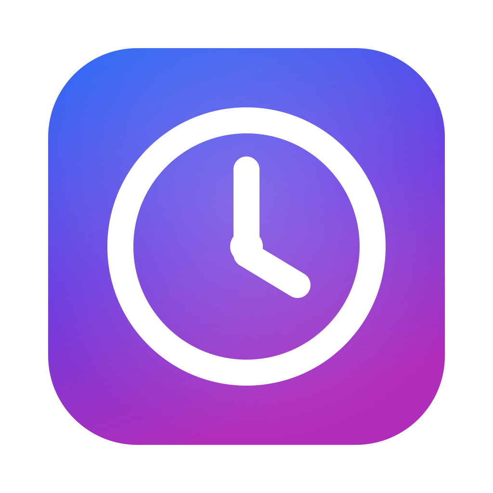
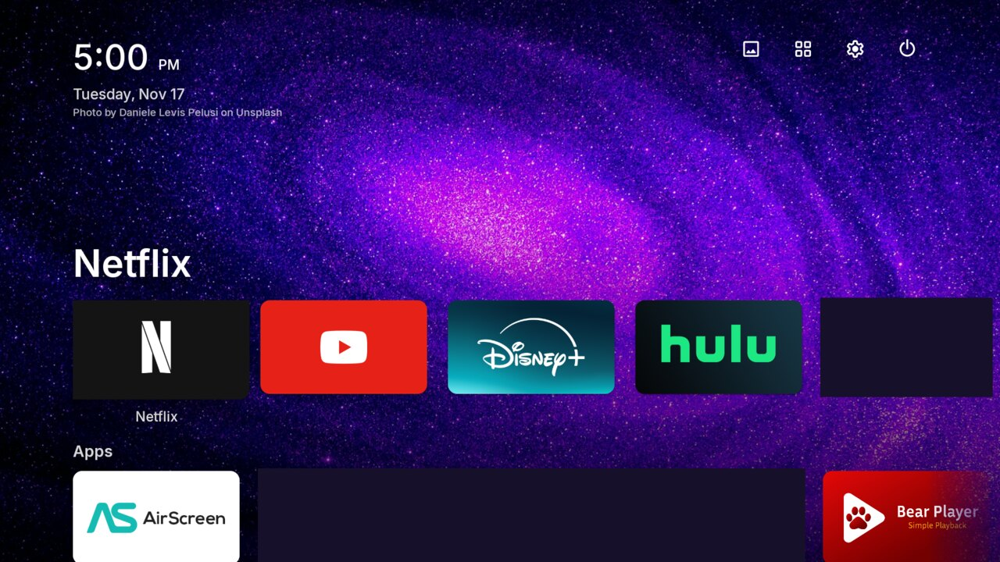
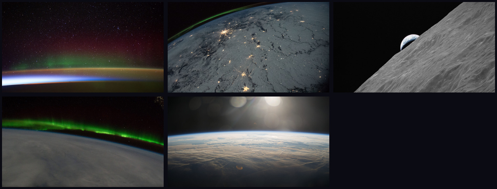
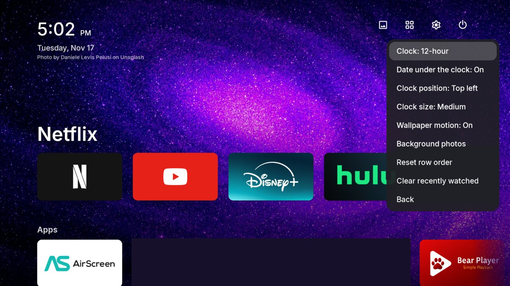

<div align="center">



# FireCasa

### A clean home screen for Amazon Fire TV. No root.

Your apps, a photo and the time. Nothing else.
Plus an optional clean-up that switches off Amazon's ads, tracking and background junk.



</div>

## What you get

- **A home screen that's just your apps.** A photo, a clock and your apps in rows, with Netflix, YouTube and the rest one press away.
- **A clock you can place.** Top left, top center or top right, in three sizes, with 12-hour AM/PM or 24-hour time. See [The clock](#the-clock).
- **The Home button opens FireCasa**, not Amazon's home screen, and FireCasa opens again after a restart.
- **Wallpapers.** Five public domain NASA photos of Earth, or a photo of your own. Unsplash photos rotate in if you add a key.
- **A clean-up that's undoable.** It switches off ads, screen tracking, telemetry and shopping. Apps are turned off, never deleted, and one button turns everything back on.
- **Updates from this repo.** FireCasa checks for a new release once a day and offers to install it from its settings.
- **Small.** About 2 MB, written in plain Java with no libraries.





## Set up

You need a Fire TV and a computer on the same Wi-Fi. No Terminal is needed for setup.

1. **Turn on ADB debugging on the Fire TV.** Go to Settings > My Fire TV > About, highlight the device name and press OK seven times. Back out, open Developer Options and turn on **ADB debugging**. Note the TV's address under Settings > My Fire TV > About > Network.
2. **Get FireCasa.** On this repo's page, press **Code > Download ZIP** and unzip it. (Or `git clone` it.)
3. **Open the setup page.** On a Mac, double-click **`setup.command`**. Your browser opens it. On Windows or Linux, run `python3 setup/server.py` (or `python` if that's how Python is named) and open the address it shows. Only macOS has been tested so far.
4. **Fill in the boxes and press the buttons:**
   - **Fire TV address.** FireCasa remembers it.
   - **Platform tools (adb).** The one thing your computer needs. The page links to the free download.
   - **Keys** for movie and show info. Optional. Each has a link to get one free.
   - **Clean up.** Preview what would change first, and pick any extras you want off.
   - **Install FireCasa.** It downloads the ready-made app, so you don't need Java or the Android SDK. Look at the TV and choose **Always allow** if it asks.

The setup page only talks to your computer and your TV. Your keys stay in `setup/keys` on your computer. They're sent to the TV, where the app keeps its own copy. The app itself never includes your keys, so the ready-made app is safe to share.

Building your own copy? If you have Java 17 and the Android SDK, the setup page builds the app instead of downloading it. See [Build it yourself](#build-it-yourself).

## Compatibility

| Device | Fire OS | Status |
| --- | --- | --- |
| Fire TV, model AFTKRT | Fire OS 8.1.8.5 | Tested: install, home screen and clock settings. The clean-up preview works. A full clean-up and undo are not yet tested on this model. |
| Other Fire TV devices on Fire OS 7 or 8 | | Untested. Reports are welcome. |
| Fire TV on Fire OS 6 | | Code path included, not yet tested. See [On Fire OS 6](#on-fire-os-6). |
| Fire TV Stick 4K Select and other Vega OS devices | Vega OS | Not expected to work. Vega OS doesn't run Android apps, so FireCasa can't install there. Untested. |
| Android TV and Google TV | | Untested as a normal launcher. Pick FireCasa as the default home screen. |

Not sure which Fire OS you have? Settings > My Fire TV > About shows it.

## The clock

Open FireCasa settings from the top-right menu on the home screen. These rows change the clock:

| Row | Options |
| --- | --- |
| Clock | 12-hour (with AM/PM) or 24-hour |
| Date under the clock | On or Off |
| Clock position | Top left, Top center, Top right |
| Clock size | Small, Medium, Big |

The photo credit for Unsplash photos sits under the date, and it moves with the clock.

## API keys

FireCasa uses three free services for the extra rows and photos. Each key is optional. Without one, its part of the home screen just doesn't show.

| Key | Used for | Where to get it |
| --- | --- | --- |
| TMDB read access token | movie and show rows, details | [themoviedb.org/settings/api](https://www.themoviedb.org/settings/api) |
| OMDb key | IMDb and Rotten Tomatoes scores | [omdbapi.com/apikey.aspx](https://www.omdbapi.com/apikey.aspx) |
| Unsplash access key | rotating background photos | [unsplash.com/developers](https://unsplash.com/developers) |

Put them in on the setup page, then press **Send keys to TV**. From the command line, put the three files in `setup/keys` (`tmdb_token.txt`, `omdb_key.txt`, `unsplash_key.txt`) and run:

```sh
./firecasa.sh keys 192.168.1.50
```

`install` sends them too. An empty or missing file turns that key off.

## Clean up Amazon's extras

The clean-up turns off Amazon's ads, tracking, telemetry and shopping. These are always included. Anything else is your choice:

| Group | What turns off | What you lose |
| --- | --- | --- |
| always | ads, automatic content recognition, recommendations, shopping, News, telemetry, demo mode, tutorials, release notes, help videos, Mayday screen sharing, Amazon Kids, Luna, Wi-Fi password sync, screensaver apps with proxy SDKs, Alexa's Spotify bridge (the Spotify app still works) | nothing you'd use |
| `alexa` | Alexa and its media, calling and multi-room audio | voice search on the mic button |
| `primevideo` | Prime Video | Prime Video |
| `livetv` | Amazon's Live TV guide, which wakes channel apps like Tubi and Fubo in the background to fill a Live tab | the Live tab, which FireCasa doesn't have. The channel apps still work when you open them. |
| `amazonapps` | Amazon Music, Amazon Photos, Silk Browser | those apps |
| `casting` | screen mirroring from phones and PCs, and Amazon's cast receiver | mirroring. Casting from Netflix and YouTube keeps working. |
| `updates` | Amazon's automatic system updates, including forced updates | security fixes from Amazon, until you turn the group back on. Check for updates by hand in Settings. |

Apps are disabled, not deleted. [debloat.txt](debloat.txt) lists every package with a note on what it is. Fire OS protects a few packages, like crash reporting and the main metrics service. The script reports those as refused and moves on. Restart the TV afterwards to free the memory.

## Undo

Use **Turn Amazon back on** on the setup page. That turns every app back on and gives the Home button back to Amazon. **Remove FireCasa too** does the same and uninstalls FireCasa.

The list of what was turned off is saved on the TV as well as on your computer, so undo works from any computer. When you're done, turn ADB debugging off in Developer Options.

## Remote

| Button | Does |
| --- | --- |
| Left, Right | move along a row |
| Up | reach the picture, apps and settings buttons |
| OK | open an app |
| Hold OK, or press Menu | put an app on the home screen, move it or take it off |
| Back | close a menu or the app drawer |

## How the Home button works

Fire OS doesn't let apps replace the home screen, and it won't disable Amazon's launcher without root. FireCasa works around that with an accessibility service. It keeps a ready copy of its home screen in an overlay window and shows it as soon as Home is pressed, so Amazon's launcher is covered as it opens. When the overlay steps aside, the screen you see is FireCasa.

This is a reaction, not a block. On a slow frame you might see a flicker of Amazon's launcher. Removing Amazon's launcher completely needs root, which FireCasa doesn't use.

Amazon's launcher still runs in the background. To open it, pick **Amazon home screen** in the top-right menu.

### On Fire OS 6

Fire OS 6 doesn't start third-party accessibility services, so FireCasa watches the system log instead. `firecasa.sh install` grants it the permissions it needs for that. It covers Amazon's launcher the same way.

Two differences:
- An app picked in the first five seconds after Home opens once those seconds are up. Pressing Amazon's tiles needs the accessibility service.
- On some remotes, Home goes to the TV and never reaches the stick. Back returns you to FireCasa from Amazon's home screen. This is from the code and has not been tested on a Fire OS 6 TV.

## Updating

FireCasa checks this repo for a newer release once a day. When one exists, its settings show **Update to FireCasa x.y.z**. Pick it, then choose **Install** when the TV asks. Your dock, wallpaper and Home button settings carry over.

Fire OS asks you to confirm each install from outside Amazon's Appstore, so an update can't be fully silent.

## Build it yourself

You need Java 17 and the Android SDK (platform 34, build-tools 34.0.0), plus platform tools (`adb`). On a Mac:

```sh
brew install --cask android-platform-tools android-commandlinetools
brew install openjdk@17
sdkmanager "platforms;android-34" "build-tools;34.0.0"
```

Then:

```sh
./build.sh                                   # builds out/firecasa.apk
./firecasa.sh install 192.168.1.50           # your Fire TV's address
```

The first install asks you to allow debugging on the TV. Choose "Always allow" and press OK.

Building needs no keys. Keys are sent to the TV separately.

## Command line

The setup page runs these for you. They're here if you prefer Terminal.

```sh
./firecasa.sh install  192.168.1.50                      # install, take over the Home button, open it
./firecasa.sh keys     192.168.1.50                      # send the keys in setup/keys
./firecasa.sh debloat  192.168.1.50 --dry-run            # show what would change
./firecasa.sh debloat  192.168.1.50                      # turn off the always-on group
./firecasa.sh debloat  192.168.1.50 --also alexa,casting # and these extras
./firecasa.sh debloat  192.168.1.50 --all                # every group
./firecasa.sh wallpaper 192.168.1.50 ~/Pictures/beach.jpg
./firecasa.sh memory   192.168.1.50                      # free memory now
./firecasa.sh undo     192.168.1.50                      # turn everything back on
./firecasa.sh undo     192.168.1.50 --uninstall          # and remove FireCasa
```

Your own wallpaper is resized to 1080p. The picture button on the home screen cycles through it and the built-in ones.

## FAQ

**Can I change the Fire TV home screen without root?**
Not with Amazon's own settings. FireCasa gets the same result with an overlay that covers Amazon's launcher, as described above.

**Is it safe?**
It only turns apps off. It never deletes them, and it never touches the launcher, Settings, the remote, Bluetooth, the Appstore or sign-in. Everything can be undone from the setup page. If undo can't reach the TV, a factory reset puts it back to stock.

**Will an Amazon update break it?**
It could. If Home stops opening FireCasa after an update, run install again from the setup page.

**Does voice search still work?**
Yes, unless you turn off the `alexa` group.

## Repository

| Path | What it is |
| --- | --- |
| `app/src/com/firecasa/home/HomeScreen.java` | the home screen, one view in plain Java |
| `app/src/com/firecasa/home/HomeService.java` | the Home button: overlay and redirect |
| `app/src/com/firecasa/home/HomeWatcher.java` | the Home button on Fire OS 6, from the system log |
| `app/src/com/firecasa/home/MainActivity.java` | FireCasa as an app, and the boot receiver |
| `app/src/com/firecasa/home/Updater.java` | checks GitHub releases and installs updates |
| `setup/` | the setup page (`index.html`) and its local server (`server.py`, standard library only) |
| `setup.command` | double-click on a Mac to open the setup page |
| `build.sh` | builds the APK with the SDK's own tools, no Gradle |
| `firecasa.sh` | install, keys, clean-up, wallpaper, memory and undo |
| `debloat.txt` | every package the clean-up can turn off, with notes |

## Credits

FireCasa started as [FireFrame](https://github.com/dyascj/FireFrame) by [@dyascj](https://github.com/dyascj) (CJ Dyas), and its code still builds on that work. Thank you.

FireCasa also borrows ideas from two other projects. [CleanFrame](https://github.com/nthnclrk/CleanFrame) by [@nthnclrk](https://github.com/nthnclrk) inspired the look: a photo, the time and a glass dock. [TV Detox](https://github.com/Ansub/tv-detox) by [@Ansub](https://github.com/Ansub) (MIT) inspired the build script and the agent-guided clean-up.

Fonts, icons, logos and photos keep their own licenses, listed in [THIRD_PARTY_NOTICES.md](THIRD_PARTY_NOTICES.md). App logos are trademarks of their owners. FireCasa isn't affiliated with Amazon or any streaming service.

MIT licensed. See [LICENSE](LICENSE).
